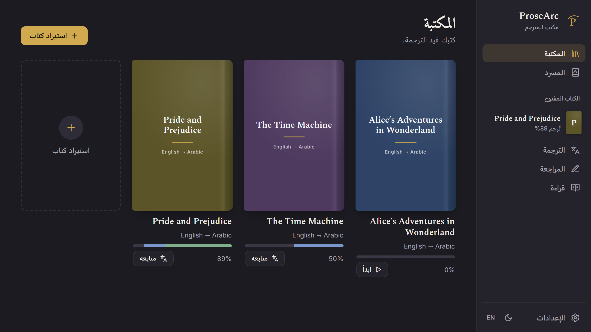
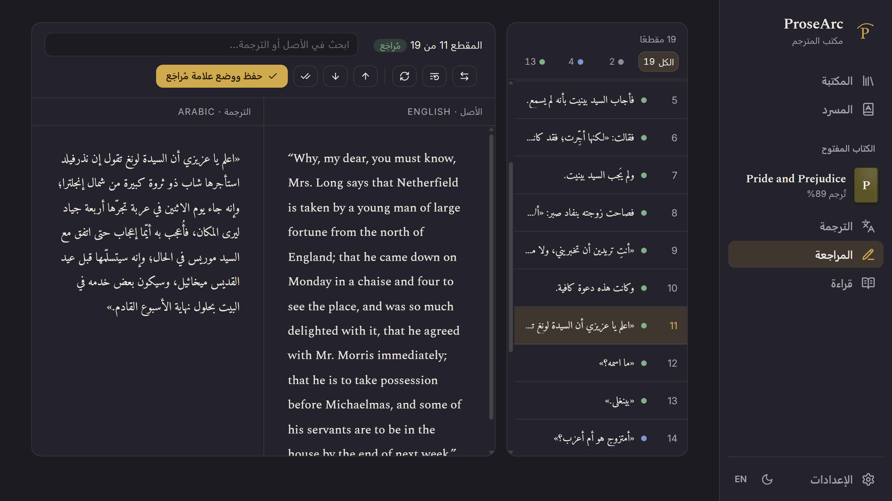
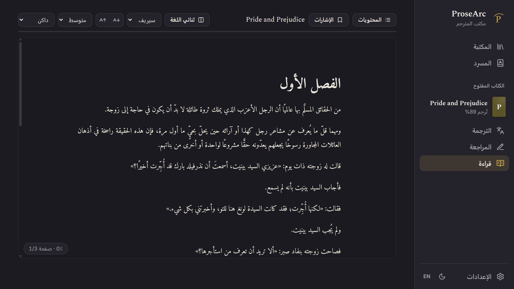
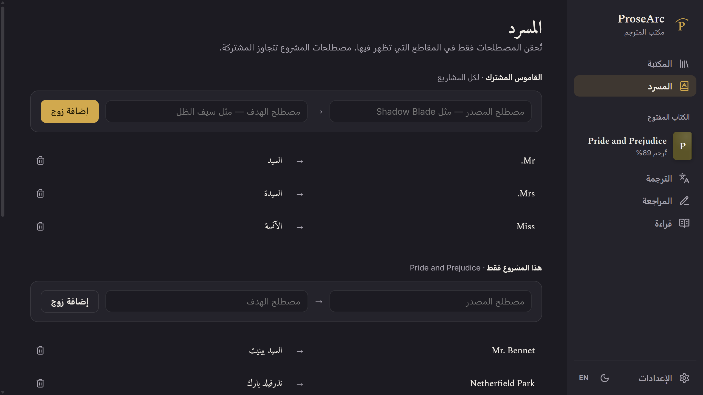
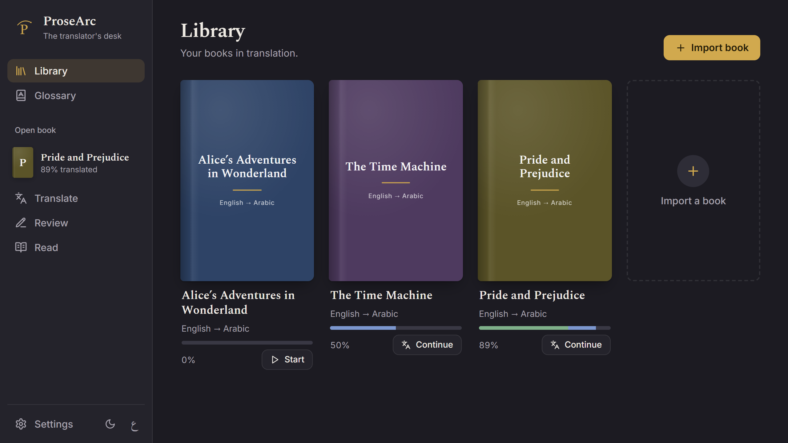
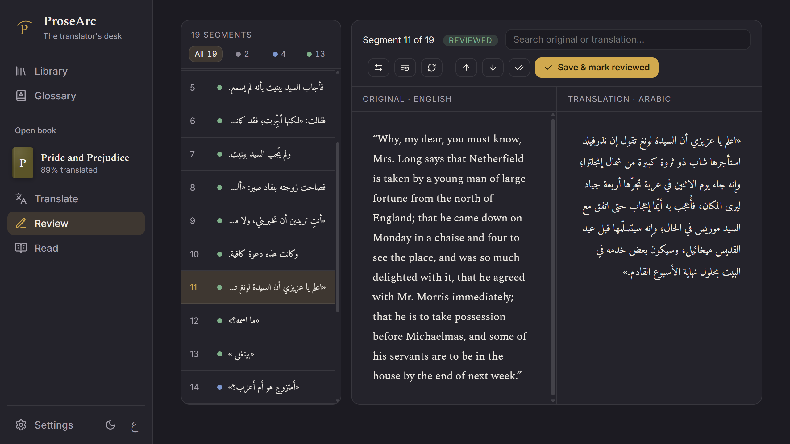
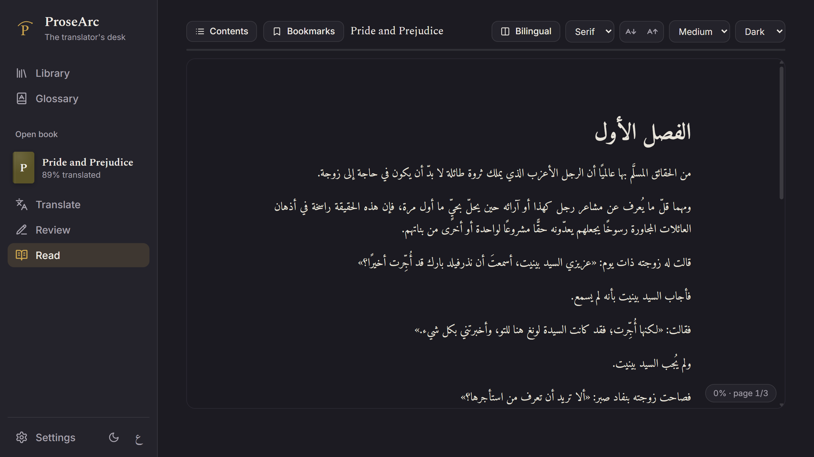
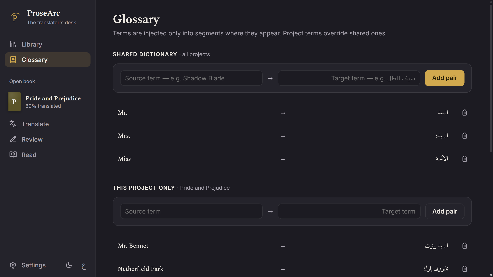

<p align="center">
  
</p>


<p align="center"><a href="#english">English ↓</a></p>

<div dir="rtl">

# ProseArc — بالعربية

**مساحة عمل لترجمة الروايات بإشراف بشري** باستخدام نموذج ذكاء اصطناعي **محلي أو سحابي**. استورد مخطوطة، ودع النموذج يُنتج ترجمة أولية، ثم راجِعها جنبًا إلى جنب، واقرأها ككتاب، وحسّنها — مع تحكّم كامل في الجودة والاتساق والأسلوب.

> **على جهازك أو عبر الإنترنت — الخيار لك.** مع المترجم المدمج (أو LM Studio / Ollama) يبقى كل طلب على جهازك. وإن ربطت مزوّدًا عبر الإنترنت، يُرسَل النص الذي تترجمه إلى ذلك المزوّد.

مبني على Electron وHTML/CSS/JS عادي — دون إطار عمل للواجهة.

## لقطات

|  |  |
| --- | --- |
|  |  |
|  |  |

## المزايا

- **مكتبة المشاريع وصفحة لكل كتاب** — كل كتاب مشروع؛ افتحه لتظهر صفحته مع **قراءة / ترجمة / مراجعة / تصدير** والتقدّم في لمحة.
- **استيراد واعٍ بالبنية** — استورد **TXT وMarkdown وEPUB وWord ‏(.docx) وPDF**. تُحفَظ العناوين والفقرات والاقتباسات والقوائم وفواصل المشاهد والتشكيل *المائل* / **العريض** خلال الترجمة وفي كل تصدير — دون تحويلها إلى نص متراصّ. تُستعاد بنية PDF بطرق استدلالية (العناوين والفقرات والتشكيل، مع إزالة الترويسات وأرقام الصفحات)؛ ملفات PDF الممسوحة ضوئيًا (صور فقط) غير مدعومة.
- **مترجم مدمج** — يشغّل نماذج GGUF عبر **llama.cpp** داخل ProseArc: لا حاجة إلى تطبيق آخر، وكل شيء على جهازك. وجّهه إلى مجلدات نماذجك (مجلد LM Studio يعمل كما هو)، أو **ابحث عن النماذج في Hugging Face ونزّلها** من داخل التطبيق — مع تقييم كل ملف لجهازك والتحقق منه بعد التنزيل. وتنزيل اختياري لمحرّك **NVIDIA (CUDA)** يجعله أسرع بعدة مرات على بطاقات NVIDIA.
- **أي مزوّد ذكاء اصطناعي** — أو ترجم عبر **LM Studio وOllama وOpenAI وClaude وGemini وOpenRouter وGroq وDeepSeek وHugging Face** أو أي خادم متوافق مع OpenAI؛ اختر لكل كتاب. مفاتيح API **مشفّرة** على جهازك ولا تدخل في الكتب أو الملفات المصدَّرة.
- **إعداد عند أول تشغيل** — يفحص جهازك (بطاقة الرسوميات، الذاكرة)، ويساعدك على الاختيار بين *هذا الجهاز* و*الإنترنت*، ويجري ترجمة تجريبية سريعة.
- **محرّك الترجمة** — يعرض التقدّم وسجلًا حيًّا؛ مهلة لكل طلب مع إعادة محاولة تلقائية؛ تشغيل قابل للاستئناف.
- **أسلوب ترجمة لكل كتاب** — موجز اختياري (النبرة، الرسمية، الجمهور) يُرسَل مع كل مقطع.
- **محرّر مراجعة بشاشة مقسّمة** — الأصل مقابل ترجمة قابلة للتحرير، **يدعم RTL** (مثل العربية)، متصفّح مُحسَّن لعشرات آلاف المقاطع، **تصفية حسب الحالة**، بحث مع **تظليل** للمطابقات، و**بحث واستبدال** في كل الترجمات.
- **القارئ** — اقرأ الترجمة النهائية ككتاب: **محتويات** الفصول، وضبط **الخط/الحجم/العرض/السمة** (داكن · بنّي · فاتح)، و**استئناف الموضع**، و**إشارات وملاحظات** لكل فقرة، وكشف **ثنائي اللغة** للأصل بنقرة.
- **المسرد** — قاموس مشترك، ومصطلحات لكل سلسلة ولكل كتاب (مصطلحات الكتاب تتقدّم على السلسلة، والسلسلة على المشتركة)، تُحقَن فقط في المقاطع التي يظهر فيها المصطلح لمنع تذبذب الأسماء — مع **أسماء مقترحة** تلقائيًا من الكتاب.
- **استيراد مجلد كامل** — يجد ProseArc كل الكتب في المجلد وفي المجلدات التي بداخله، ويصبح كل مجلد **سلسلة** في مكتبتك، بإعدادات واحدة للكل. ثم **قائمة ترجمة** تترجم الكتب واحدًا تلو الآخر (إيقاف مؤقت، استئناف، تغيير الترتيب)، وتبقى بعد إغلاق التطبيق.
- **المجلدات المراقَبة** — يتحقق ProseArc من مجلداتك عند بدء التشغيل أو حين تضغط «تحقّق الآن»، ويضيف الكتب الجديدة إلى سلسلتها. الترجمة التلقائية للكتب الجديدة خيار لكل مجلد، معطّل افتراضيًا.
- **التصدير** — TXT وMarkdown وPDF وEPUB (يدعم RTL)، مع تنبيه إن بقي أي مقطع غير مترجم.
- **الإعدادات** — الافتراضيات للكتب الجديدة، وصفحة **المزوّدين** (بطاقة لكل مزوّد مع اختبار وقائمة نماذجه)، والمترجم المدمج (المحرّك، مجلدات النماذج، التحديثات مع التراجع)، والمظهر.
- **لمسات** — مظهر نظيف يستخدم النافذة كلها، خطوط مضمّنة (Spectral / Amiri / Inter)، سمتان داكنة وفاتحة، أغلفة للكتب (تُولَّد إن لم يكن للكتاب غلاف)، اختصارات لوحة المفاتيح (F1)، وواجهة كاملة **بالإنجليزية / العربية** مع RTL.
- **يحدّث نفسه** — يتحقق التطبيق المثبَّت من وجود إصدار جديد على GitHub عند تشغيله، أو في أي وقت من **الإعدادات ← التحديثات**.

## القادم

- توقيع رقمي للتطبيق، حتى يتوقف تحذير ويندوز عند أول تشغيل.

## التنزيل والتشغيل

لمعظم الناس — دون Node ودون إعداد:

**[⬇ نزّل أحدث إصدار](https://github.com/Faadred/ProseArc/releases/latest)** (ويندوز)

- **المثبِّت** (`ProseArc‑Setup‑*.exe`) — يضيف اختصارًا في قائمة ابدأ وأداة إزالة، أو
- **المحمول** (`ProseArc‑*‑portable.exe`) — ملف واحد، انقر نقرًا مزدوجًا فحسب.

> لأن التطبيق غير موقَّع رقميًا، قد يعرض ويندوز تحذير SmartScreen («حمى ويندوز جهازك»). اضغط **مزيد من المعلومات ← التشغيل على أي حال**.

## ستحتاج أيضًا إلى نموذج

عند أول تشغيل، يفحص **إعداد** ProseArc جهازك ويرشدك عبر أحد الخيارين. يمكنك تغيير ذلك متى شئت من **الإعدادات ← المزوّدون**، أو لكل كتاب.

**على هذا الجهاز — خاص ومجاني وبلا إنترنت.**
- **المترجم المدمج:** أضف مجلدًا فيه نماذج ‎`.gguf` (مثل مجلد نماذج LM Studio)، أو استخدم **البحث عن نماذج عبر الإنترنت** لتنزيل نموذج من Hugging Face. يشغّله ProseArc بنسخته الخاصة من llama.cpp.
- **LM Studio أو Ollama:** إن كنت تستخدم أحدهما، حمّل نموذجًا فيه واختره في ProseArc.

**عبر الإنترنت — يعمل على أي جهاز، ويحاسبك المزوّد حسب الاستخدام، ويُرسَل نص كتابك إليه.**
1. احصل على مفتاح API من المزوّد (في كل بطاقة مزوّد رابط لذلك).
2. في **الإعدادات ← المزوّدون**، افتح المزوّد والصق المفتاح واضغط **حفظ واختبار**.
3. اختر نموذجًا من قائمته عبر **استخدمه للكتب الجديدة**، أو اختر واحدًا لكل كتاب.

> النماذج التي لم يُختبر معها ProseArc قد تترجم أسوأ، خصوصًا إلى العربية.

## كيفية الاستخدام

**استورد كتابًا** (`.txt` أو `.md` أو `.epub` أو `.docx` أو `.pdf`) واضبط لغتيه. في صفحة الكتاب اضغط **ابدأ** للترجمة، وحسّنها في **المراجعة**، و**اقرأها** ككتاب، و**صدّرها** إلى TXT / Markdown / PDF / EPUB. اضغط **F1** لاختصارات لوحة المفاتيح.

## البناء من المصدر

يلزم فقط إن أردت تشغيله أو بناءه بنفسك. يتطلّب **[Node.js](https://nodejs.org/) 18+**.

```bash
npm install
npm start             # التشغيل للتطوير (أو انقر start.bat مرتين)
npm run fetch-engine  # تنزيل محرّك llama.cpp المضمَّن في التطبيق (مع التحقق)
npm run dist          # تنزيل المحرّك ثم بناء نسخة محمولة ومثبِّت في dist/
```

## أين تُحفَظ البيانات

كل مشروع ملف JSON واحد داخل مجلد بيانات التطبيق في نظامك — `%APPDATA%\prosearc\projects\` على ويندوز. عمليات الحفظ ذرّية (تُكتب في ملف مؤقت ثم يُعاد تسميته)، فلا يترك أي انقطاع مشروعًا تالفًا. يوجد المسرد المشترك بجوار ذلك المجلد في `%APPDATA%\prosearc\glossary-global.json`، مع الإعدادات ومفاتيح API المشفّرة ونسخ المحرّك المنزَّلة (`engine\`). أما النماذج فتبقى في مجلدات نماذجك.

## الرخصة

MIT — انظر [LICENSE](LICENSE).

</div>

---

<a id="english"></a>

# ProseArc — in English

A **human‑in‑the‑loop workspace for translating novels** with a **local or cloud** AI model. Import a manuscript, let the model produce a first‑pass translation, then review it side‑by‑side, read it as a book, and polish it — keeping full control over quality, consistency, and tone.

> **On your PC or online — your choice.** With the built‑in translator (or LM Studio / Ollama), every AI call stays on your machine. If you connect an online provider, the text you translate is sent to that provider.

Built with Electron + plain HTML/CSS/JS — no UI framework.

## Screenshots

|  |  |
| --- | --- |
|  |  |
|  |  |

---

## Features

- **Project library & per‑book hub** — each book is one project; open it to a page with **Read / Translate / Review / Export** and progress at a glance.
- **Structure‑aware import** — import **TXT, Markdown, EPUB, Word (.docx), or PDF**. Headings, paragraphs, block quotes, lists, scene breaks, and *italic* / **bold** emphasis are preserved through translation and back out to every export — not flattened into a wall of text. PDF structure is reconstructed heuristically (headings, paragraphs, emphasis; running headers and page numbers are stripped); scanned/image‑only PDFs are not supported.
- **Built‑in translator** — runs GGUF models with **llama.cpp** inside ProseArc: no other app needed, fully on your PC. Point it at your model folders (LM Studio's folder works as is), or **find and download models from Hugging Face** in the app — each file rated for your PC and checked after download. An optional **NVIDIA (CUDA)** engine download makes it several times faster on NVIDIA cards.
- **Any AI provider** — or translate with **LM Studio, Ollama, OpenAI, Claude, Gemini, OpenRouter, Groq, DeepSeek, Hugging Face**, or any OpenAI‑compatible server; choose per book. API keys are **encrypted** on your PC and never go into books or exports.
- **First‑run setup** — checks your PC (graphics card, memory), helps you pick *on this PC* or *online*, and runs a quick test translation.
- **Translation engine** — streams progress and a live activity log; per‑request timeout + auto‑retry; resumable runs.
- **Per‑book translation style** — an optional brief (tone, formality, audience) sent with every segment.
- **Split‑screen review editor** — original vs. editable translation, **RTL‑aware** (e.g. Arabic), a virtualized navigator for tens of thousands of segments, **filter by status**, search with live match **highlighting**, **find & replace** across all translations, and one‑click *retranslate* / *mark all reviewed*.
- **Reader** — read the finished translation as a book: chapter **contents**, adjustable **font / size / width / theme** (dark · sepia · light), **resume position**, per‑paragraph **bookmarks & notes**, and **bilingual** tap‑to‑reveal of the original.
- **Glossary** — a shared dictionary, plus terms per series and per book (a book's terms win over its series', a series' over shared ones), injected only into segments where a term appears, to stop name‑drift — plus **auto‑suggested names** detected from the book.
- **Import a whole folder** — ProseArc finds every book in a folder and the folders inside it; each folder becomes a **series** in your library, with one set of settings for all. A **translation queue** then translates them one after another (pause, resume, reorder) and survives closing the app.
- **Watched folders** — ProseArc checks your folders when it starts or when you press **Check now**, and adds new books to their series. Translating new books automatically is a per‑folder switch, off by default.
- **Export** — TXT, Markdown, PDF, and EPUB (RTL‑aware), with a warning if any segment is still untranslated.
- **Settings** — defaults for new books, a **Providers** page (one card per provider, with a test and its model list), the built‑in translator (engine, model folders, updates with Undo), and appearance.
- **Polish** — a clean look that uses the whole window, bundled fonts (Spectral / Amiri / Inter), dark + light themes, book covers (generated when a book has none), keyboard shortcuts (F1), and a full **English / Arabic** interface with RTL.
- **Updates itself** — the installed app checks GitHub for a new version on start, or any time from **Settings → Updates**.

## Coming next

- Code signing, so Windows stops warning on first run.

---

## Download & run

For most people — no Node, no setup:

**[⬇ Download the latest release](https://github.com/Faadred/ProseArc/releases/latest)** (Windows)

- **Installer** (`ProseArc‑Setup‑*.exe`) — adds a Start Menu shortcut + uninstaller, or
- **Portable** (`ProseArc‑*‑portable.exe`) — a single file, just double‑click.

> Because the app isn't code‑signed, Windows SmartScreen may say *“Windows protected your PC.”* Click **More info → Run anyway**.

## You'll also need: a model

On first run, ProseArc's **Setup** checks your PC and walks you through one of these. You can change it any time in **Settings → Providers**, or per book.

**On this PC — private, free, offline.**
- **Built‑in translator:** add a folder with `.gguf` models (for example LM Studio's models folder), or use **Find models online** to download one from Hugging Face. ProseArc runs it with its own copy of llama.cpp.
- **LM Studio or Ollama:** if you already use one, load a model there and pick it in ProseArc.

**Online — works on any PC, the provider charges per use, your book's text is sent to them.**
1. Get an API key from the provider (each provider card has a link).
2. In **Settings → Providers**, open the provider, paste the key, and press **Save and test**.
3. Pick a model from its list with **Use for new books**, or choose one per book.

> Models ProseArc hasn't been tested with may translate worse, Arabic especially.

## Using ProseArc

**Import a book** (`.txt`, `.md`, `.epub`, `.docx`, or `.pdf`) and set its languages. On the book's page, press **Start** to translate, polish it in **Review**, **Read** it as a book, and **Export** to TXT / Markdown / PDF / EPUB. Press **F1** for keyboard shortcuts.

---

## Build from source

Only needed if you want to run or build it yourself. Requires **[Node.js](https://nodejs.org/) 18+** (developed on 26).

```bash
npm install
npm start             # run in dev (or double-click start.bat)
npm run fetch-engine  # download the llama.cpp engine the app bundles (checked)
npm run dist          # fetch the engine, then build a portable .exe + installer into dist/
```

## Where data lives

Each project is a single JSON file under your OS per‑app data folder — `%APPDATA%\prosearc\projects\` on Windows (i.e. `C:\Users\<you>\AppData\Roaming\prosearc\projects\`). Saves are atomic (written to a temp file, then renamed into place), so an interrupted save never leaves a half‑written, corrupt project. The shared glossary sits alongside that folder at `%APPDATA%\prosearc\glossary-global.json`, with settings, the encrypted API keys, and downloaded engine builds (`engine\`). Models stay in your own model folders.

## License

MIT — see [LICENSE](LICENSE).
